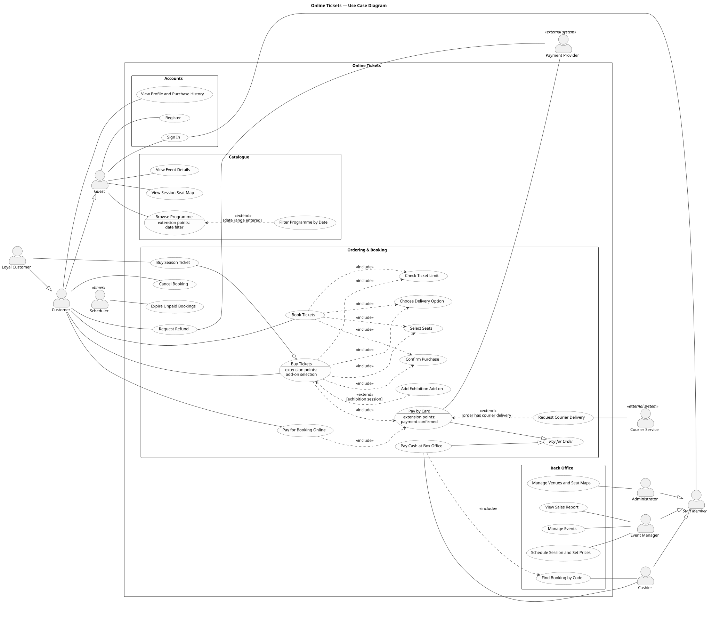

# Lab 5 — Use Case Diagram

**Project:** Online Tickets (Project 3)
**Diagram source:** `docs/diagrams/use-case.puml` (PlantUML) → rendered `docs/diagrams/use-case.svg`
(regenerate with `scripts/render-diagrams.sh`).
**Inputs:** requirements list (Lab 3, `lab03-requirements-list.md`, v1.3): FR IDs and business rules BR-1…BR-7.

**Notation used in the diagram**

| Element | How it is drawn |
|---|---|
| System boundary | Rectangle "Online Tickets"; actors are outside it, use cases inside. |
| Component (subsystem) | Package inside the boundary. |
| Association | Solid line, only between an actor and a use case. |
| Include | Dashed arrow from the base use case to the included one, `«include»`. |
| Extend | Dashed arrow from the extending use case to the base one, `«extend»` + condition in brackets; the base use case lists its extension points. |
| Generalization | Solid line with a hollow triangle from the child to the parent (actors and use cases). |
| Abstract use case / actor | Name in italics ("Pay for Order", "Staff Member"); it is never performed or played on its own, only through its children. |

## 1. Checklist against the task

| Task requirement | Our diagram |
|---|---|
| At least 3 actors | 10 actors: Guest, Customer, Loyal Customer, Staff Member, Cashier, Event Manager, Administrator, Payment Provider, Courier Service, Scheduler |
| At least 2 components of the system | 4 components (packages) inside the "Online Tickets" boundary: Catalogue, Accounts, Ordering & Booking, Back Office |
| At least 10 use cases | 28 use cases (UC01–UC28) |
| Association | e.g. Guest — Browse Programme; Customer — Buy Tickets; Pay by Card — Payment Provider, Request Refund — Payment Provider (secondary actor) |
| Include | e.g. Buy Tickets «include» Select Seats, Check Ticket Limit, Choose Delivery Option, Confirm Purchase, Pay by Card; Book Tickets «include» Select Seats, Check Ticket Limit, Choose Delivery Option, Confirm Purchase; Pay Cash at Box Office «include» Find Booking by Code |
| Extend | Filter Programme by Date «extend» Browse Programme [date range entered]; Add Exhibition Add-on «extend» Buy Tickets [exhibition session]; Request Courier Delivery «extend» Pay by Card [order has courier delivery] |
| Generalization | Actors: Customer → Guest; Loyal Customer → Customer; Cashier / Event Manager / Administrator → Staff Member. Use cases: Pay by Card / Pay Cash at Box Office → Pay for Order; Buy Season Ticket → Buy Tickets |
| Workflow tables | Section 5: one table per use case started by an actor (main path + alternative paths) |

## 2. Actors

| Actor | Type | Description |
|---|---|---|
| Guest | Primary | Visitor who is not signed in; browses the programme, registers or signs in. Guests cannot buy or book (BR-1). |
| Customer | Primary | Registered user; inherits everything a guest can do; buys and books tickets, requests refunds, sees profile and history. A customer who is not loyal is a *regular customer* (0–3 paid orders, BR-3); the regular customer has no use cases of its own, so it is not drawn as a separate actor. |
| Loyal Customer | Primary | Customer with more than 3 paid orders; refunded orders do not count (BR-3). Additionally buys season tickets. |
| Staff Member | Primary (abstract) | Common parent of the box office and back-office roles; signs in with a staff account. |
| Cashier | Primary | Box office employee; finds bookings by code, accepts cash. |
| Event Manager | Primary | Manages events, sessions, prices and add-ons; views sales reports. |
| Administrator | Primary | Manages venues, halls and seat maps. |
| Payment Provider | Secondary (external system) | Charges the bank card on its own page and reports the result (BR-6); refunds card payments on request (FR-33, FR-45). |
| Courier Service | Secondary (external system) | Receives delivery requests for printed tickets and reports their status. |
| Scheduler | Primary (timer) | System clock that starts the expiry job; models time-triggered behaviour. |

## 3. Use cases and traceability to the ToR (Lab 3)

| ID | Use case | Component | Requirements |
|---|---|---|---|
| UC01 | Browse Programme | Catalogue | FR-01 |
| UC02 | Filter Programme by Date | Catalogue | FR-02 |
| UC03 | View Event Details | Catalogue | FR-03, FR-04, FR-05 |
| UC04 | View Session Seat Map | Catalogue | FR-06 |
| UC05 | Register | Accounts | FR-07 |
| UC06 | Sign In | Accounts | FR-08, NFR-11, NFR-23 |
| UC07 | View Profile and Purchase History | Accounts | FR-09, FR-29 |
| UC08 | Buy Tickets | Ordering & Booking | FR-10…FR-17, BR-1, BR-2, BR-7 |
| UC09 | Buy Season Ticket | Ordering & Booking | FR-31, FR-32, BR-3 |
| UC10 | Select Seats | Ordering & Booking | FR-10, FR-12 |
| UC11 | Check Ticket Limit | Ordering & Booking | FR-14, BR-2 |
| UC12 | Add Exhibition Add-on | Ordering & Booking | FR-13 |
| UC13 | Choose Delivery Option | Ordering & Booking | FR-16, FR-47 |
| UC14 | Confirm Purchase | Ordering & Booking | FR-15, FR-17 |
| UC15 | *Pay for Order* (abstract) | Ordering & Booking | FR-28, FR-30 |
| UC16 | Pay by Card | Ordering & Booking | FR-24, FR-25, FR-45, BR-6 |
| UC17 | Pay Cash at Box Office | Ordering & Booking | FR-22, FR-47, NFR-12 |
| UC18 | Request Courier Delivery | Ordering & Booking | FR-26, FR-27 |
| UC19 | Book Tickets | Ordering & Booking | FR-15, FR-18, FR-44, FR-46, FR-47, BR-4 |
| UC20 | Pay for Booking Online | Ordering & Booking | FR-20, FR-25 |
| UC21 | Cancel Booking | Ordering & Booking | FR-23 |
| UC22 | Expire Unpaid Bookings | Ordering & Booking | FR-19, FR-11, BR-4, BR-7 |
| UC23 | Find Booking by Code | Back Office | FR-21 |
| UC24 | Manage Events | Back Office | FR-34 |
| UC25 | Schedule Session and Set Prices | Back Office | FR-35, FR-36 |
| UC26 | Manage Venues and Seat Maps | Back Office | FR-37 |
| UC27 | View Sales Report | Back Office | FR-38 |
| UC28 | Request Refund | Ordering & Booking | FR-33, BR-5, BR-3, NFR-12 |

Requirements not shown as separate use cases: FR-39 (cash sale without a booking) is *Could*
priority and is left for a later release; FR-40…FR-43 are *Won't*. FR-33 (refund) is *Could* in
Lab 3, but the team implements it in release 1, so it is shown as UC28.

## 4. Why these relationships

- **Include** is used for steps that always run as part of the base use case: every purchase
  selects seats (or a ticket quantity for exhibitions), checks the 3-ticket limit, chooses delivery
  and is confirmed, and "Buy Tickets" (pay now) is always paid by card (Pay by Card); every booking
  does the same steps but is not paid at confirmation; an online booking payment is always by
  card; a cash payment always starts by finding the booking by its code.
- **Extend** is used for optional behaviour with a condition, inserted at an extension point of
  the base use case: the date filter (only if the user enters a date range), exhibition add-ons
  (only for exhibition sessions, extension point "add-on selection"), the courier delivery request
  (only if the order has courier delivery, extension point "payment confirmed" of "Pay by Card").
  It extends "Pay by Card" because courier delivery requires card payment and the request is sent
  only after the payment is confirmed, whether the card payment is part of "Buy Tickets" or of
  "Pay for Booking Online".
- **Generalization of use cases**: "Pay for Order" is abstract and holds what every payment does
  (mark tickets paid, issue e-tickets, update the paid-order count and loyalty status). It has
  two concrete forms: card online (with the Payment Provider) and cash at the box office (with
  the Cashier). "Buy Season
  Ticket" is a special form of "Buy Tickets" that covers sessions of several events and is allowed
  only for loyal customers; it inherits all includes and extensions of "Buy Tickets".
- **Generalization of actors**: a Customer can do everything a Guest can; the Loyal Customer
  is a kind of Customer and is the only actor associated with "Buy Season Ticket" (a regular
  customer is a plain Customer). Cashier, Event Manager and Administrator are kinds of Staff Member and inherit "Sign In".
- **Pay now or book** (FR-15, FR-44, FR-46, FR-47): the choice at confirmation decides the use
  case. Paying now by card is "Buy Tickets" (UC08): the order is created with status "pending
  payment" and its seats are held for 10 minutes from confirmation, the time to pay at the
  provider (BR-7). Booking is "Book Tickets" (UC19): the customer chooses it explicitly or by
  choosing the payment method "cash at the box office". It is offered only if the earliest
  session starts more than 24 hours later (FR-44), gets a booking code instead of a hold, and
  expires 24 hours before the earliest session (BR-4, UC22). The booking is paid later by the
  cashier (UC17) or online by card (UC20). Courier delivery requires card payment (FR-47): it is
  allowed for a pay-now order and for a booking paid online, but a courier booking cannot be paid
  in cash.
- **Refund** (UC28): only a card-paid order can be refunded, and only if the earliest session of
  the order starts more than 24 hours later (BR-5). The Payment Provider is a secondary actor of the
  refund, as it is of the card payment.

## 5. Use case workflows

Use cases that are only included (UC10, UC11, UC13, UC14, UC16, UC23), extend another one (UC02,
UC12, UC18) or are abstract (UC15) are described as steps inside the workflows of the use cases
that use them.

### UC01 Browse Programme (with UC02 Filter Programme by Date)

| Step | Actor action | System response | Notes |
|---|---|---|---|
| 1 | Guest opens the programme page | System shows upcoming events with type, dates and venue | Main path |
| 2 | Guest selects an event type | System shows only events of that type (FR-01) | — |
| 2a | Guest enters a date range | System shows only events with sessions in that range (UC02) | Extension point "date filter" |
| 2b | — | No event matches the filters: system shows "no events found" | Alternative path |

### UC03 View Event Details and UC04 View Session Seat Map

| Step | Actor action | System response | Notes |
|---|---|---|---|
| 1 | Guest opens an event from the programme | System shows title, type, description, duration, age rating and the list of sessions with prices per zone | FR-03…FR-05 |
| 2 | Guest opens a seated session | System shows the seat map with row, seat, price and status of every seat | FR-06 |
| 2a | Session is an exhibition | System shows the remaining capacity and add-ons instead of a seat map | Alternative path |

### UC05 Register

| Step | Actor action | System response | Notes |
|---|---|---|---|
| 1 | Guest enters name, e-mail and password | System validates the data | — |
| 2 | — | System creates a customer account with status "regular" and signs the user in | Main path |
| 2a | E-mail is already registered or data invalid | System shows an error; no account is created | Alternative path |

### UC06 Sign In

| Step | Actor action | System response | Notes |
|---|---|---|---|
| 1 | Guest or staff member enters e-mail and password | System checks the password hash | — |
| 2 | — | System issues an access token valid for 24 hours and shows the functions of the user's role | Main path (NFR-11) |
| 2a | Wrong e-mail or password | System shows "invalid credentials" | Alternative path |

### UC07 View Profile and Purchase History

| Step | Actor action | System response | Notes |
|---|---|---|---|
| 1 | Customer opens the profile | System shows the customer's status (regular or loyal) | FR-09 |
| 2 | Customer opens the history | System lists all orders and bookings with event, session, tickets, total and status (booked, paid, cancelled, expired, refunded); active bookings show the booking code | FR-29 |
| 2a | Customer has no orders | System shows an empty history | Alternative path |

### UC08 Buy Tickets (pay now by card)

| Step | Actor action | System response | Notes |
|---|---|---|---|
| 1 | Customer opens a session of an event | System shows the seat map with prices and free/taken seats | Precondition: customer is signed in (BR-1) |
| 2 | Customer selects 1–3 free seats (UC10) | System shows the selected seats and their prices | FR-10; for an exhibition the customer enters a number of tickets instead (FR-12) |
| 2a | Session is an exhibition: customer adds add-ons (UC12) | System checks the remaining capacity of each add-on and adds them to the order | Extension point "add-on selection" |
| 3 | — | System checks that the order has at most 3 tickets for this event (UC11) | BR-2; the same limit for every customer |
| 3a | More than 3 tickets for one event | System rejects the order with an explanation | Alternative path |
| 4 | Customer chooses a delivery option (UC13): e-ticket (default) or courier delivery with an address | System calculates the delivery fee and the total | FR-16; courier delivery requires card payment |
| 5 | Customer checks the summary, chooses "pay now" with the payment method "bank card" and confirms (UC14) | System checks that the seats are still free, creates the order (status "pending payment"), holds its seats for 10 minutes and redirects to the payment provider (UC16) | FR-11, FR-17, BR-7; card data is entered only at the provider (BR-6) |
| 5a | A seat was taken meanwhile | System shows "seat no longer available"; no order is created | Alternative path |
| 5b | Customer chooses to book, or chooses the payment method "cash at the box office" | The order is not paid now: the flow continues as UC19 step 5 | Alternative path (FR-46); allowed only if the earliest session starts more than 24 h later (FR-44) |
| 5c | Customer does not pay within the 10-minute hold | System expires the order (UC22); the seats return to sale | Alternative path (BR-7) |
| 6 | Customer pays at the provider | Provider confirms the payment; system marks the order paid, issues e-tickets, increases the paid-order count and marks the customer loyal when it becomes greater than 3 | Main path (FR-24, FR-28, FR-30) |
| 6a | Payment is declined | System keeps the order unpaid and shows an error; the customer may retry until the hold expires | Alternative path (FR-25) |
| 6b | Provider confirms the payment after the hold has expired | System issues no tickets and requests an automatic refund of the payment from the provider | Alternative path (FR-45) |
| 7 | — | If courier delivery was chosen, system sends a delivery request to the courier service (UC18) | Extension point "payment confirmed" of UC16 (FR-26) |

### UC09 Buy Season Ticket

| Step | Actor action | System response | Notes |
|---|---|---|---|
| 1 | Loyal customer starts a season-ticket order | System checks that the customer has more than 3 paid orders (refunded orders do not count) | BR-3, FR-32 |
| 1a | Customer is not loyal | System rejects the season-ticket order | Alternative path |
| 2 | Customer adds sessions of 2 or more different events, selecting seats for each | System checks the 3-ticket limit for each event separately | Inherited steps of UC08 (BR-2) |
| 2a | Sessions belong to fewer than 2 events | System does not allow confirmation | Alternative path (FR-31) |
| 3 | Customer chooses delivery, confirms and pays by card | Same as UC08 steps 4–7 | Main path |
| 3a | Customer books the season ticket instead | Same as UC08 step 5b; the booking expires 24 h before the earliest session | Alternative path (BR-4) |

### UC19 Book Tickets (pay later: cash at the box office or online by card)

| Step | Actor action | System response | Notes |
|---|---|---|---|
| 1 | Customer opens a session of an event | System offers booking only if the session starts more than 24 hours later | FR-44, BR-4; precondition: signed in (BR-1); with several sessions the earliest one counts |
| 1a | Session starts in 24 hours or less | System does not offer booking; only card purchase (UC08) is possible | Alternative path |
| 2 | Customer selects 1–3 free seats (UC10) | System shows the selection; no 10-minute hold is created | The hold exists only for a pay-now card order (BR-7) |
| 3 | — | System checks the 3-ticket limit per event (UC11) | BR-2; rejected if exceeded |
| 4 | Customer chooses a delivery option (UC13): e-ticket (default) or courier delivery with an address | System calculates the delivery fee and the total | FR-16 |
| 5 | Customer chooses to book with the payment method "bank card" (pay online later) or "cash at the box office", checks the summary and confirms (UC14) | System checks that the seats are still free, creates a booking, marks the seats as booked and issues an 8-character booking code | Main path (FR-15, FR-18, FR-46) |
| 5a | A seat was taken meanwhile | System shows "seat no longer available"; no booking is created | Alternative path |
| 5b | Courier delivery together with the payment method "cash at the box office" | System rejects the order: courier delivery requires card payment | Alternative path (FR-47) |
| 6 | Customer sees the code and the deadline (24 h before the earliest session) | — | The code is also shown in the history; the booking is paid at the box office (UC17, not for courier delivery) or online (UC20) |

### UC20 Pay for Booking Online

| Step | Actor action | System response | Notes |
|---|---|---|---|
| 1 | Customer opens an active booking in the history and presses "Pay" | System checks that the booking is still active | — |
| 1a | Booking is expired or cancelled | System shows an error | Alternative path |
| 2 | Customer pays by card (UC16) | Provider confirms; system marks the booking's tickets paid, issues e-tickets and updates the paid-order count | Main path (FR-20, FR-28, FR-30) |
| 2a | Payment is declined | Booking stays active until its deadline; the customer may retry | Alternative path (FR-25) |
| 2b | Provider confirms the payment after the booking has expired | System issues no tickets and requests an automatic refund of the payment | Alternative path (FR-45) |
| 3 | — | If the booking has courier delivery, system sends a delivery request to the courier service (UC18) | Extension point "payment confirmed" of UC16 (FR-26) |

### UC21 Cancel Booking

| Step | Actor action | System response | Notes |
|---|---|---|---|
| 1 | Customer opens an active booking and presses "Cancel" | System asks for confirmation | — |
| 2 | Customer confirms | System sets the booking status to "cancelled" and releases its seats | Main path (FR-23) |
| 2a | Booking is already paid, expired or cancelled | System refuses the cancellation | Alternative path |

### UC17 Pay Cash at Box Office

| Step | Actor action | System response | Notes |
|---|---|---|---|
| 1 | Cashier enters the booking code given by the customer | System finds the booking (UC23) and shows session, seats, total | — |
| 1a | Code not found, or booking expired | System shows an error | Alternative path |
| 1b | Booking has courier delivery | System refuses the cash payment; the customer can pay the booking online (UC20) | Alternative path (FR-47) |
| 2 | Cashier receives cash and presses "Paid in cash" | System marks the booking's tickets paid, issues e-tickets, updates the paid-order count and writes an audit record | Main path (FR-22, NFR-12) |
| 2a | Booking already paid or cancelled | System refuses the payment | Alternative path |

### UC22 Expire Unpaid Bookings

| Step | Actor action | System response | Notes |
|---|---|---|---|
| 1 | Scheduler triggers the job every minute | System finds active bookings whose earliest session starts in 24 hours or less | BR-4 |
| 2 | — | System sets their status to "expired" and releases their seats | Seats return to sale (FR-19) |
| 3 | — | System also expires unpaid pay-now card orders whose 10-minute hold has run out and releases their seats | BR-7, FR-11 |
| 3a | Nothing to expire | Job ends without changes | Alternative path |

### UC28 Request Refund

| Step | Actor action | System response | Notes |
|---|---|---|---|
| 1 | Customer opens a paid order in the history and presses "Refund" | System checks that the order was paid by card and that its earliest session starts more than 24 hours later | FR-33, BR-5 |
| 1a | Order was paid in cash at the box office | System does not offer a refund | Alternative path; refunds only for card-paid orders |
| 1b | The earliest session of the order starts in 24 hours or less | System refuses the refund | Alternative path (BR-5) |
| 2 | Customer confirms the refund | System asks the payment provider to refund the full amount of the order | — |
| 3 | — | Provider confirms; system sets the order status to "refunded", cancels its e-tickets, returns the seats to sale and writes an audit record | Main path (NFR-12); the order no longer counts as a paid order (BR-3) |
| 3a | Provider reports an error | Order stays paid; system shows an error and the customer may try again | Alternative path |

### UC24 Manage Events

| Step | Actor action | System response | Notes |
|---|---|---|---|
| 1 | Event manager creates or edits an event (title, type, description, duration, age rating) | System validates and saves the event | Main path (FR-34) |
| 1a | Required field is missing | System shows the error and does not save | Alternative path |

### UC25 Schedule Session and Set Prices

| Step | Actor action | System response | Notes |
|---|---|---|---|
| 1 | Event manager selects an event, a hall, a date and a start time | System checks that the hall is free at that time | — |
| 1a | Hall is already used at that time | System rejects the session | Alternative path |
| 2 | Event manager enters a price for each price zone (and add-ons with price and capacity for an exhibition) | System saves the session and writes an audit record of the prices | Main path (FR-35, FR-36, NFR-12) |

### UC26 Manage Venues and Seat Maps

| Step | Actor action | System response | Notes |
|---|---|---|---|
| 1 | Administrator creates a venue and a hall | System saves them | — |
| 2 | Administrator enters rows, seats and price zones, or a general-admission capacity | System saves the seat map | Main path (FR-37) |
| 2a | Seat map has duplicate seats | System shows the error and does not save | Alternative path |

### UC27 View Sales Report

| Step | Actor action | System response | Notes |
|---|---|---|---|
| 1 | Event manager selects an event or a session | System shows tickets sold, revenue and occupancy in % per session | Main path (FR-38) |
| 1a | No tickets sold yet | System shows zero values | Alternative path |
