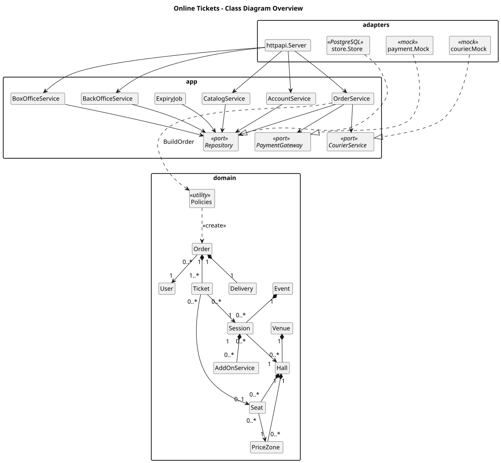
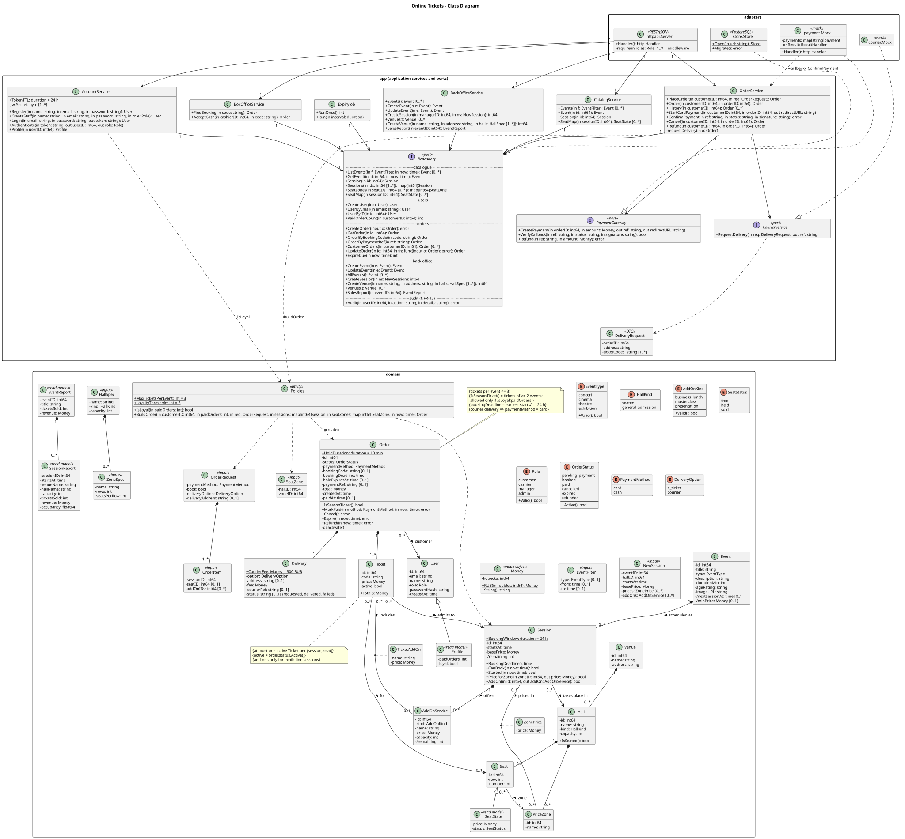

# Lab 6 — Detailed UML Class Diagram and Choice of Architecture

**Project:** Online Tickets (Project 3)
**Diagram sources:** `docs/diagrams/class-diagram.puml` (detailed) and
`docs/diagrams/class-overview.puml` (overview) → `.svg` files next to them.

> Prepared from the lecture "Class Modeling, Detailed Object-Oriented Software Design" and the lab
> plan ("Detailed class diagram: choice of architecture (final, with justification) — OOAD").
> The Moodle task for this lab opens on 22 Oct 2026 19:00; re-check this document against it.

The model is kept in sync with the implementation in `backend/internal/`: `domain` (entities and
business rules), `app` (application services and ports), `store` with `migrations/001_init.sql`
(PostgreSQL adapter), `payment` and `courier` (mock providers) and `httpapi` (REST adapter).

### How to open the diagram

Each `.puml` file is one self-contained `@startuml … @enduml` block (no includes, themes or
sprites), so it can be used in three ways:

- **PlantUML web server:** open <https://www.plantuml.com/plantuml/uml/>, replace the text with the
  contents of the file and press *Submit*.
- **draw.io / diagrams.net:** *Arrange → Insert → Advanced → PlantUML…*, paste the contents of the
  file, press *Insert*. The diagram stays editable as PlantUML (double-click it).
- **Locally:** `scripts/render-diagrams.sh` renders every `docs/diagrams/*.puml` to SVG with
  Docker (`plantuml/plantuml:1.2024.7`).

The overview shows the layers and the main classes; the detailed diagram shows every class with
attributes, operations and multiplicities.





## 1. Class modelling process (OOA)

### 1.1 Problem statement (one sentence)
Customers choose an event session, pick seats (or a number of exhibition tickets with add-ons),
and either pay by card now or book with a code and pay later online or in cash, while the system
guarantees that no seat is sold twice.

### 1.2 Informal strategy (one paragraph)
An **event** has **sessions**; each session takes place in a **hall** of a **venue**. A seated hall
has **seats** grouped into **price zones**; the session sets a **price** per zone. An exhibition
hall has a capacity instead of seats; its session has a base **price** and offers **add-on
services** with their own capacity. A **customer** puts tickets into an **order request**, chooses
a **payment method** and a **delivery** option, and confirms. If they pay by **card** now, the
system creates an **order** in "pending payment" and **holds** its seats for 10 minutes while the
**payment provider** takes the payment. If they **book** (or choose **cash**), the order gets a
**booking code** and stays "booked" until 24 hours before the earliest session; it is paid later
online or in cash by a **cashier**. A paid card order may be **refunded** until the same
**deadline**. **Courier delivery** costs a flat fee and needs card payment. A customer with more
than three paid orders is **loyal** and may order a **season ticket** that covers several events.
No more than three tickets for one event are allowed in one order. Cash payments, refunds and price
changes are written to an **audit log**.

### 1.3 Noun extraction and filtering

Nouns were taken from the brief, the ToR (Lab 3) and the use case workflows (Lab 5).

| Candidate noun | Decision | Reason |
|---|---|---|
| Event | **Class** `Event` | Core concept with own data (FR-03). |
| Session (schedule item) | **Class** `Session` | Has date/time, prices, add-ons (FR-04). |
| Hall, Venue | **Classes** `Hall`, `Venue` | A venue has several halls with different layouts (FR-37). |
| Seat | **Class** `Seat` | Row, number, zone; target of a ticket (FR-06). |
| Price zone | **Class** `PriceZone` | Groups seats with one price (FR-05). |
| Price | **Association class** `ZonePrice` (seated); attribute `Session.basePrice` (exhibition) | The price of a seat depends on both session and zone. |
| Add-on service | **Class** `AddOnService` | Price and capacity per session (FR-13, FR-36). |
| Add-on chosen for a ticket | **Association class** `TicketAddOn` | Keeps the price at the moment of sale. |
| Customer, cashier, event manager, administrator | **Class** `User` + enum `Role` | All have the same data; they differ only in rights, checked by role. |
| Regular / loyal customer | **Derived** (`IsLoyal(paidOrders)`; shown in `Profile`) | Status changes at run time; subclasses would force object re-creation. |
| Order, purchase | **Class** `Order` | Unit of purchase and booking; has a life cycle. |
| Seat hold | **State** `pending_payment` + `Order.holdExpiresAt` | A hold is a card order waiting for the provider; its active tickets block the seats. |
| Booking | **State** `booked` + `Order.bookingCode` | An order not yet paid; a separate class would duplicate tickets and totals. |
| Season ticket | **Query** `Order.IsSeasonTicket()` | An order whose tickets cover ≥ 2 events. |
| Ticket, e-ticket | **Class** `Ticket` | One admission; links order, session and seat; has a unique code (FR-28). |
| Payment | **Attributes of `Order`** (`paymentMethod`, `paymentRef`, `paidAt`) | The provider keeps payment attempts; the order needs only the provider reference and the time of payment. |
| Delivery | **Class** `Delivery` (part of `Order`) | Option, address, fee, courier reference and status (FR-16, FR-27). |
| Courier service, payment provider | **Interfaces (ports)** `CourierService`, `PaymentGateway` | External systems (AC-4, AC-5). |
| Ticket limit, loyalty threshold, price calculation | `Policies` (`BuildOrder`, `IsLoyal`, constants) | Business rules in one pure, unit-tested place (BR-2, BR-3, NFR-16). |
| Payment method, delivery option, statuses, event type, hall kind, add-on kind, role | **Enumerations** | Fixed value sets. |
| Money, price, total, fee | **Value object** `Money` | Amount in kopecks avoids float rounding. |
| Audit log | **Operation** `Repository.Audit` (table `audit_log`) | NFR-12; written only, never read by the domain. |
| Box office, programme, schedule, auditorium, seat map, sales report | Not domain entities | Box office = cashier's UI; programme = list of events (`EventFilter`); schedule = sessions of an event; auditorium = hall; seat map = read model `SeatState`; report = read model `EventReport`. |
| Card number | Out of scope | Never received by the system (BR-6). |

## 2. Classes

Notation: Go package-level constants and functions are shown as static members (underlined);
Go struct embedding (`Profile` embeds `User`, `SeatState` embeds `Seat`) is shown as
generalization. Foreign keys and display copies (`eventTitle`, `venueName`, …) are drawn as
associations, not attributes. Every parameter shows its UML direction: `in` (input), `out` (an extra Go return
value, e.g. `Login(..., out token)`) or `inout` (modified in place, e.g. `CreateOrder(inout o)`
fills the generated IDs). Omitted for brevity: the `context.Context` parameter, a trailing Go `error`
result when the operation has another result (failures are the typed errors of `errors.go`), and
the `Now` (clock, replaced in tests) and `Log` fields of the services.

### 2.1 Domain classes

| Class | Responsibility | Key invariants |
|---|---|---|
| `Venue`, `Hall`, `PriceZone`, `Seat` | Physical layout. | `seated` hall: seats in zones of the same hall. `general_admission` hall: `capacity`, no seats. |
| `Event` | Programme item. | `/nextSessionAt`, `/minPrice` are filled only for the programme list. |
| `Session` | Schedule item; price and add-on lookup; deadlines. | `BookingDeadline() = startsAt − BookingWindow (24 h)`; `CanBook(now) ⇔ now < BookingDeadline()`; `Started(now) ⇔ now ≥ startsAt`. `basePrice` and `/remaining` apply to general admission. |
| `ZonePrice` | Price of one zone in one session (association class). | Zone belongs to the session's hall. |
| `AddOnService` | Business lunch, masterclass, presentation of an exhibition session. | Sold add-ons ≤ `capacity`. |
| `User`, `Profile` | Account with role; profile adds `paidOrders` and `loyal`. | `loyal = IsLoyal(paidOrders)`. |
| `Order` | Life cycle of a purchase (section 3), payment reference, total. | `total` = ticket prices + add-on prices + delivery fee; `bookingDeadline` = earliest session start − 24 h, stored for every order. |
| `Ticket` | One admission to a session (seat or general admission). | `active` ⇔ order status is `pending_payment`, `booked` or `paid`; at most one active ticket per (session, seat). |
| `Delivery` | E-ticket or courier delivery (part of the order). | `courier` ⇒ address set, `fee = CourierFee (300 RUB)`, payment method `card`. |
| `Policies` | `BuildOrder` — the order factory; `IsLoyal`. | See 2.2. |
| `OrderRequest`, `OrderItem`, `SeatZone`, `EventFilter`, `NewSession`, `HallSpec`, `ZoneSpec` | Inputs (what the customer confirms; what staff create). | — |
| `SeatState`, `EventReport`, `SessionReport` | Read models (seat map; sales report). | — |
| `Money` | Value object (kopecks). | Immutable. |

### 2.2 Business rules in the domain

`BuildOrder(customerID, paidOrders, req, sessions, seatZones, now)` validates and prices an
`OrderRequest` and returns a new `Order` or a typed error (`errors.go`):

| Rule | Check in `BuildOrder` | Error |
|---|---|---|
| BR-2 / FR-14 | ≤ `MaxTicketsPerEvent` (3) tickets of one event in the order, for every customer | `ErrTicketLimit` |
| BR-3 / FR-31 / FR-32 | `IsSeasonTicket()` (≥ 2 events) only if `IsLoyal(paidOrders)` (> 3 paid, non-refunded orders) | `ErrNotLoyal` |
| BR-4 / FR-44 | booking (`book` or `cash`): `Session.CanBook(now)` for every session | `ErrBookingClosed` |
| FR-47 | courier delivery requires `card` and an address | `ErrCourierNeedsCard`, `ErrAddressRequired` |
| Pricing | seat: `Session.PriceForZone(zone)`; general admission: `basePrice`; plus add-ons (exhibitions only); plus `CourierFee` | `ErrSeatNotInHall`, `ErrAddOnNotAllowed`, `ErrUnknownAddOn` |
| BR-7 / FR-11, FR-18, FR-46 | `card` without `book` → `pending_payment`, `holdExpiresAt = now + HoldDuration (10 min)`; otherwise → `booked` | — |

Seat and capacity availability is checked by the store inside the order transaction
(`ErrSeatTaken`, `ErrSoldOut`). Booking and ticket codes are generated by `OrderService`.

### 2.3 Application services, ports and adapters

| Class | Use cases | Notes |
|---|---|---|
| `CatalogService` | UC01–UC04 | Read-only. |
| `AccountService` | UC05–UC07 | `Login` returns a JWT (`TokenTTL` = 24 h); `Authenticate` checks it for the HTTP middleware; `Profile` uses `PaidOrderCount` and `IsLoyal` (FR-09); `CreateStaff` is used for seeding. |
| `OrderService` | UC07–UC16, UC18–UC21, UC28 | `PlaceOrder` loads sessions and seat zones, calls `BuildOrder`, generates the codes and saves with `CreateOrder`. `StartCardPayment` calls `PaymentGateway.CreatePayment` and returns the provider page URL. State changes go through `Repository.UpdateOrder(id, fn)`, which locks the row and calls an `Order` method. |
| `BoxOfficeService` | UC17, UC23 | `AcceptCash` = `MarkPaid(cash, now)`; audited. |
| `BackOfficeService` | UC24–UC27 | `CreateSession` checks the prices against the hall zones; audited. |
| `ExpiryJob` | UC22 | `Run` calls `RunOnce` = `Repository.ExpireDue(now)` every interval (1 min). |
| `Repository` | — | One persistence port, grouped into catalogue, users, orders, back office and audit operations; implemented by `store.Store` (PostgreSQL). |
| `PaymentGateway`, `CourierService`, `DeliveryRequest` | UC16, UC18, UC20, UC28 | Ports to the external providers (AC-4, AC-5); implemented by `payment.Mock` and `courier.Mock` (AC-6). `VerifyCallback` checks the provider's signature; the mock delivers the signed result straight to `OrderService.ConfirmPayment` (`onResult`), a real provider calls `POST /api/payments/callback`. |
| `httpapi.Server` | all | REST/JSON adapter: routes, JWT and role checks (`require`), payment provider callback; maps domain errors to HTTP codes. |

### 2.4 Relationship choices

| Relationship | Kind | Why |
|---|---|---|
| `Venue` ◆— `Hall` ◆— `Seat`, `PriceZone` | Composition | A hall or seat has no meaning without its venue/hall. A venue is created before its halls (`0..*`). |
| `Event` ◆— `Session`; `Session` ◆— `AddOnService` | Composition | A session belongs to one event; an add-on to one session. |
| `Order` ◆— `Ticket` (`1..*`), `Delivery` (`1`) | Composition | Created and stored with the order; e-ticket is the default delivery. |
| `Session` → `Hall`, `Seat` → `PriceZone`, `Ticket` → `Session`, `Ticket` → `Seat` (`0..1`), `Order` → `User` | Directed association | Independent objects; the code navigates only in the arrow direction (foreign key on the source). No seat for general admission. |
| `Session` — `PriceZone` with `ZonePrice`; `Ticket` — `AddOnService` with `TicketAddOn` | Association classes | The link itself carries a price. |
| `User` ◁— `Profile`, `Seat` ◁— `SeatState` | Generalization | Read models extend the entity (Go embedding). |
| Services → `Repository`, `PaymentGateway`, `CourierService`; `httpapi.Server` → services | Directed association | Fields set at start-up (dependency injection). |
| `store.Store`, `payment.Mock`, `courier.Mock` ⋯▷ ports | Interface realization | Ports and adapters (NFR-17). |
| `Policies` ⋯> `Order` «create»; services ⋯> `Policies`; `payment.Mock` ⋯> `OrderService` «callback» | Dependency | Used inside operations or as a callback function, not stored as an object link. |

## 3. Order state machine

| From | Operation (trigger) | Guard (error if violated) | To |
|---|---|---|---|
| — | `BuildOrder` via `OrderService.PlaceOrder` (customer confirms, card, pay now) | rules of 2.2; seats free | `pending_payment` (`holdExpiresAt = now + 10 min`) |
| — | `BuildOrder` via `PlaceOrder` (`book` or `cash`) | rules of 2.2; `CanBook(now)` | `booked` (`bookingCode`) |
| `pending_payment` | `MarkPaid(card, now)` (provider confirms) | `now < holdExpiresAt` (`ErrHoldExpired`) | `paid` (`paidAt`) |
| `booked` | `MarkPaid(card \| cash, now)` (provider confirms / cashier) | `now < bookingDeadline` (`ErrBookingClosed`); cash ⇒ no courier delivery (`ErrCourierNeedsCard`, FR-47) | `paid` |
| `pending_payment`, `booked` | `Cancel()` (customer) | — | `cancelled` |
| `pending_payment` | `Expire(now)` (`ExpiryJob`, late confirmation) | `now ≥ holdExpiresAt` | `expired` |
| `booked` | `Expire(now)` (`ExpiryJob`, late confirmation) | `now ≥ bookingDeadline` | `expired` |
| `paid` | `Refund(now)` (customer) | `paymentMethod = card` (`ErrRefundCardOnly`); `now < bookingDeadline` (`ErrRefundClosed`) | `refunded` |

`cancelled`, `expired` and `refunded` are final; the transition deactivates the tickets, which
returns the seats to sale. Any other transition returns `ErrInvalidTransition`. `ExpiryJob` runs
the same two expiry rules for all due orders in one SQL statement (`Repository.ExpireDue`).

| Rule | Where enforced |
|---|---|
| BR-1 registered customers only | HTTP middleware checks the role; services take the customer ID from the token. |
| BR-3 / FR-30 loyalty | `Repository.PaidOrderCount` counts `paid` orders (refunded ones are `refunded`), then `IsLoyal`. |
| FR-24 / NFR-05 paid only after confirmation, idempotent | `OrderService.ConfirmPayment` checks the signature (`VerifyCallback`), finds the order by `paymentRef` and calls `MarkPaid`; a repeated callback finds `paid` and changes nothing. |
| FR-25 failed payment | A declined result leaves the order `pending_payment`/`booked`; `StartCardPayment` can be retried until the hold or the booking expires. |
| FR-45 late confirmation | `MarkPaid` returns `ErrHoldExpired`/`ErrBookingClosed` → `ConfirmPayment` calls `Expire(now)`; or the order is already `expired`/`cancelled` (`ErrInvalidTransition`). In both cases it calls `PaymentGateway.Refund(paymentRef, total)` and the order is not paid. |
| FR-26 / FR-27 courier request | After `paid`, `requestDelivery` sends a `DeliveryRequest` (order, address, ticket codes) to `CourierService.RequestDelivery`; `Delivery.courierRef` and `status = requested` (or `failed`) are saved. |
| BR-5 / FR-33 refund | `Order.Refund(now)` and `PaymentGateway.Refund` in one `UpdateOrder` transaction (a failed provider refund leaves the order `paid`); audited. |

## 4. Traceability

### 4.1 Use cases (Lab 5) → classes and operations

| Use case | Classes / operations |
|---|---|
| UC01 Browse Programme, UC02 Filter Programme by Date | `CatalogService.Events(EventFilter)` |
| UC03 View Event Details | `CatalogService.Event`, `Session` → `Event`, `Session`, `ZonePrice` |
| UC04 View Session Seat Map | `CatalogService.SeatMap` → `SeatState` |
| UC05 Register, UC06 Sign In | `AccountService.Register`, `Login`, `Authenticate` |
| UC07 View Profile and Purchase History | `AccountService.Profile`, `OrderService.History` |
| UC08 Buy Tickets | `OrderService.PlaceOrder(OrderRequest)` → `BuildOrder` |
| UC09 Buy Season Ticket | `PlaceOrder` with items of ≥ 2 events; `IsSeasonTicket`, `IsLoyal` |
| UC10 Select Seats | `OrderItem.seatID`; `SeatState`; `Ticket.active` |
| UC11 Check Ticket Limit | `BuildOrder` (`MaxTicketsPerEvent`) |
| UC12 Add Exhibition Add-on | `OrderItem.addOnIDs`; `Session.AddOn`; `TicketAddOn` |
| UC13 Choose Delivery Option | `OrderRequest.deliveryOption`; `Delivery`; `CourierFee` |
| UC14 Confirm Purchase | `PlaceOrder`; `Order.total` |
| UC15 Pay for Order | `Order.MarkPaid` |
| UC16 Pay by Card | `OrderService.StartCardPayment` → `PaymentGateway.CreatePayment`; `OrderService.ConfirmPayment` → `VerifyCallback`, `Order.MarkPaid` |
| UC17 Pay Cash at Box Office | `BoxOfficeService.AcceptCash` → `Order.MarkPaid(cash)`; `Repository.Audit` |
| UC18 Request Courier Delivery | `OrderService.requestDelivery` → `CourierService.RequestDelivery(DeliveryRequest)`; `Delivery.courierRef`, `status` |
| UC19 Book Tickets | `PlaceOrder` with `book`/`cash`; `Session.CanBook` |
| UC20 Pay for Booking Online | `OrderService.StartCardPayment` (booked order); `ConfirmPayment` |
| UC21 Cancel Booking | `OrderService.Cancel`; `Order.Cancel` |
| UC22 Expire Unpaid Bookings | `ExpiryJob.Run` → `RunOnce` → `Repository.ExpireDue`; `Order.Expire` (same rules) |
| UC23 Find Booking by Code | `BoxOfficeService.FindBooking`; `Repository.OrderByBookingCode` |
| UC24 Manage Events | `BackOfficeService.Events`, `CreateEvent`, `UpdateEvent` |
| UC25 Schedule Session and Set Prices | `BackOfficeService.CreateSession(NewSession)` with `ZonePrice`, `AddOnService` |
| UC26 Manage Venues and Seat Maps | `BackOfficeService.Venues`, `CreateVenue(HallSpec, ZoneSpec)` |
| UC27 View Sales Report | `BackOfficeService.SalesReport` → `EventReport` |
| UC28 Request Refund | `OrderService.Refund`; `Order.Refund`; `PaymentGateway.Refund` |

### 4.2 Requirements (Lab 3) → model

| Requirements | Model elements |
|---|---|
| FR-01–FR-06 (catalogue) | `CatalogService`, `EventFilter`, `Event`, `Session`, `ZonePrice`, `SeatState` |
| FR-07–FR-09 (accounts) | `AccountService.Register/Login`, `User`, `Profile`, `IsLoyal` |
| FR-10–FR-17, FR-46, FR-47 (ordering) | `OrderService.PlaceOrder`, `OrderRequest`, `BuildOrder`, `Delivery`, `TicketAddOn`, `Hall.capacity` |
| FR-18–FR-23, FR-44 (booking) | `Order.bookingCode`, `Session.CanBook`, `ExpiryJob`, `BoxOfficeService`, `Order.Cancel` |
| FR-24–FR-28, FR-45 (payment, delivery) | `PaymentGateway`, `OrderService.StartCardPayment/ConfirmPayment`, `Order.paymentRef`, `MarkPaid`, `CourierService`, `DeliveryRequest`, `Delivery.status`, `Ticket.code` |
| FR-29–FR-33 (history, loyalty, refunds) | `OrderService.History/Refund`, `IsLoyal`, `IsSeasonTicket`, `Order.Refund` |
| FR-34–FR-38 (back office) | `BackOfficeService`, `NewSession`, `HallSpec`, `EventReport` |
| FR-39 (Could: cash sale without booking) | Not modelled; the cashier uses the booking flow. |
| NFR-04, NFR-05, NFR-10, NFR-12, NFR-16, NFR-17 | Section 5.3. |

## 5. Choice of architecture (final, with justification)

### 5.1 Decision
**Client–server web application** (AC-2) built as a **modular monolith** with a
**ports-and-adapters (hexagonal)** structure:

```
React SPA ──HTTPS/JSON──► Go API server ──SQL──► PostgreSQL
                            adapters     HTTP API · store.Store · mock payment · mock courier
                            application  services, ports
                            domain       entities, value objects, BuildOrder / IsLoyal
```

Dependency rule: `adapters → application → domain`. `domain` has no I/O and imports nothing of
the project; `application` reaches the database and external systems only through ports. The
code follows it: `internal/domain` imports nothing of the project, `internal/app` imports only
`domain`, the adapters (`store`, `payment`, `courier`, `httpapi`) import only `app` and `domain`,
and `cmd/api/main.go` wires the adapters into the services.

### 5.2 Alternatives considered

| Alternative | Cons for our project | Verdict |
|---|---|---|
| Microservices (catalogue, orders, payments) | "Seat + order + payment" becomes a distributed transaction; operations cost too high for 3–4 students (AC-9); NFR-03 load does not need it | Rejected |
| Serverless functions | Cold starts hurt NFR-01; limited providers in Russia (NFR-20, AC-7) | Rejected |
| Server-rendered monolith | Seat map needs a rich client; AC-1 fixes React | Rejected |
| Layered monolith without ports | Payment/courier code mixed into services; NFR-16, NFR-17 harder | Rejected |
| **Modular monolith + SPA, hexagonal** | Scales as one unit — acceptable for NFR-03 because the API is stateless and can run in replicas | **Selected**: one ACID database for seat consistency, replaceable providers, testable domain |

### 5.3 How the architecture meets the key requirements

| Requirement | Mechanism |
|---|---|
| NFR-04 no double sale | Partial unique index `tickets(session_id, seat_id) WHERE active`; `CreateOrder` locks the order's sessions (`SELECT … FOR UPDATE`) and re-checks general-admission and add-on capacity in the same transaction. |
| NFR-05 payment consistency | Signed provider result (`VerifyCallback`); `UpdateOrder` locks the order row and applies `MarkPaid` only from a valid status; `payment_ref` is unique. |
| BR-4, BR-7, FR-19 expiry | `ExpireDue`: one statement expires `pending_payment` orders with `hold_expires_at ≤ now` and `booked` orders with `booking_deadline ≤ now`, then deactivates their tickets. |
| NFR-01–NFR-03 performance | Stateless API (JWT) can run in several replicas; seat map is one indexed query. |
| NFR-09, NFR-11, NFR-23 security | bcrypt hashes (cost 10); JWT (`TokenTTL` = 24 h) with role claim; role checks in HTTP middleware (`require`). |
| NFR-10 no card data | Card data only on the provider page; the order stores only `paymentRef`. |
| NFR-12 audit | `Repository.Audit` (`audit_log` table) called by `BoxOfficeService.AcceptCash`, `OrderService.Refund`, `BackOfficeService.CreateSession` (prices). |
| NFR-16 testability | `domain` is pure; `domain_test.go` covers `BuildOrder` and transitions; ports and the `Clock` let services be tested with fakes. |
| NFR-17 replaceable providers | `PaymentGateway`, `CourierService` interfaces; mock adapters now (AC-6). |
| NFR-18, NFR-20 deployment | `docker compose up` starts PostgreSQL, API and web on a host in Russia. |
